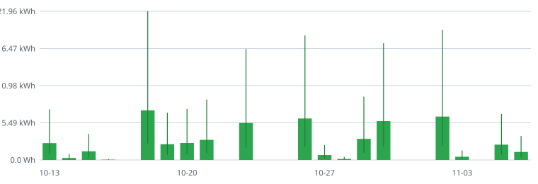

# How much energy does my Claude use take?

I use Claude a lot for my research and side projects. I want to be mindful about my energy consumption, and I'm curious what all those tokens actually add up to. So this repository keeps a running count of the tokens I use in Claude Code, estimates the energy behind them, and puts that next to everyday things like boiling a kettle or streaming a video.

The numbers are estimates, with honest error bars: no AI company publishes the energy per token for its models, so the range runs from three times lower to three times higher than the central figure. How it's worked out, and every assumption, is below.

**See it week by week, in interactive charts: [annabelle-grimes.com/energy](https://annabelle-grimes.com/energy/).**

## My usage so far

<!-- summary:start -->
*Updated 06 November 2026, covering 2026-10-13 to 2026-11-06 (18 days with use).*

| | Low | **Central** | High |
|---|---|---|---|
| All time | 17.02 kWh | **51.06 kWh** | 153 kWh |
| Last 30 days | 17.02 kWh | **51.06 kWh** | 153 kWh |
| An average day with use | 946 Wh | **2.84 kWh** | 8.51 kWh |

**All time, the central estimate is about the same energy as:** 663 × an hour of streaming video; 511 × boiling a litre of water in a kettle; 300 × driving an electric car 1 km; 51 × running a fridge for a day.

**An average day of use is about:** 37 × an hour of streaming video; 28 × boiling a litre of water in a kettle; 17 × driving an electric car 1 km; 2.8 × running a fridge for a day.



*Bars: central estimate per day. Lines: low to high.*

Tokens so far: 6.7 million output (including thinking), 13.2 thousand fresh input, 29.9 million written to the prompt cache and 2.3 billion read back from it.

**Where the energy goes:** 76% re-reading the conversation so far (cache reads); 11% writing replies and thinking (output); 12% adding new context to the cache; 0% fresh input. Long sessions re-read a long history with every reply, so starting fresh conversations (or `/clear`) is the biggest saving.

| Model | Responses | Tokens | Energy (central) |
|---|---|---|---|
| `claude-opus-5-5` | 5,942 | 2.3 billion | 51.04 kWh |
| `claude-haiku-4-5` | 39 | 2.0 million | 19.7 Wh |
<!-- summary:end -->

## How it works

1. **Tokens.** Claude Code records the token usage of every response in its local logs (`~/.claude/projects/`). `tracker/update.py` adds them up by day and model into [`data/daily.csv`](data/daily.csv) (and by week into [`data/weekly.json`](data/weekly.json), which the charts read): fresh input, input written to the prompt cache, input read back from the cache, and output (which includes Claude's thinking). Only these daily totals are kept: no prompts, replies, file names or project names.
2. **Weighting.** Not all tokens take the same work. Writing a token of output costs far more computing than reading one in, a cached token far less, and a big model more than a small one. Anthropic's list prices reflect this, so each day's tokens are priced at list price and the energy is taken to scale with that price. Prices are in [`tracker/assumptions.json`](tracker/assumptions.json).
3. **Energy.** The scale comes from what has been published for a typical chatbot answer, about 1,000 tokens in and 500 out: around **0.3 Wh**, taken here for a mid-sized model (Claude Sonnet 5.5). The low and high estimates use 0.1 Wh and 0.9 Wh.
   - Epoch AI (2025) estimated about 0.3 Wh for a typical GPT-4o query.
   - Google (2025) measured 0.24 Wh for the median Gemini text prompt, data-centre overheads included.
   - OpenAI (2025) gave 0.34 Wh for the average ChatGPT query.
4. **Comparisons.** The totals are set against everyday energy uses, also in `tracker/assumptions.json` with their sources: a Google search (0.3 Wh), a phone charge (15 Wh), an hour of streaming video (77 Wh, IEA), boiling a litre of water (100 Wh), and more.

## What it leaves out

- **Only Claude Code.** Chats on claude.ai or in the desktop app aren't logged on my computer, so they aren't counted.
- **Only running the model.** Not the energy that went into training it, building the hardware or the data centre, or my own computer and network.
- **Energy, not emissions.** How much carbon this means depends on the electricity grid behind the data centre, which I don't know.
- **Price as a stand-in for work.** Prices are set by a business, not a power meter, so the weighting between models and token types is approximate.

## Update it

Needs Python 3, nothing to install:

```sh
python tracker/update.py
git add -A && git commit -m "Update usage" && git push
```

Claude Code deletes old logs after 30 days by default, so run this at least once a month: `data/daily.csv` keeps every day it has seen, and the history grows from there.

To change an assumption (a price, the 0.3 Wh anchor, a comparison), edit `tracker/assumptions.json` and run the script again; it recalculates everything from the token counts.
